 

I'm a **Full Stack Software Engineer** with **8+ years** building and integrating systems. At **Total Express** I work on event-driven architectures on AWS that connect operations to a huge network of partners: from marketplaces like **Amazon, Mercado Livre, Shopee, Magazine Luiza, AliExpress, TikTok and SHEIN** to banks like **Nubank, Inter and Bradesco** in card operations.

I've worked as a **tech lead**, I join technical meetings with **international clients in English**, and I'm studying **Artificial Intelligence at FIAP**, going deeper into LLMs, neural networks and Data Science.

 

 

**Full Stack Software Engineer · Total Express** · 2022 – today 
2022–2024 contracted through Plus-IT Tech

- Laravel REST APIs and microservices for large-scale e-commerce integrations.
- Asynchronous architectures with **Kafka and RabbitMQ** processing **millions of records a day**.
- **AWS Lambda** + **SQS** for scalable async processing; unit and integration tests with PHPUnit, pytest and unittest.

**Tech Lead · ZPT Digital** · 2021 – 2022

- Led the development committee and sprint planning; technical direction of the team's deliveries.

**Full Stack Developer · ZPT Digital** · 2019 – 2022

- Front-end and back-end with PHP, C#, Python and JavaScript; MySQL/SQL administration and server maintenance.
- Server and database migrations, files to **AWS S3**, scheduled jobs on **EC2** and APIs connecting internal systems.

**Internships · Support & Development · ZPT Digital (2019) and Argus (2018 – 2019)**

- Development and support of the main systems, requirements analysis and customer support.

 

<b>How the Amazon International integration works</b>

 

1. **Capture.** EventBridge schedules trigger Lambdas that pull manifests, commercial invoices and KYC data from Amazon's SFTP, decrypting the files. A flow control built on S3 and SNS only starts processing once every file has arrived.
2. **Processing.** Each manifest gets a unique ID, is split into configurable batches stored on S3, and goes through a chain of SQS + Lambda steps that add KYC data and the USD exchange rate before a batched submission to the international partner.
3. **Tracking & feedback.** Statuses are fetched in batches, mapped through a lookup table and sent back to Amazon as XML over SFTP. Every queue has a DLQ, and failures go to an error log table that generates the error report for Amazon.

 

**Certifications:** Machine Learning Professional (FIAP, 2025) · Introduction to Generative AI (Google Cloud, 2025) · Gen AI Hackathon (FIAP · Google Cloud, 2025) · Oracle Certified Foundations Associate (2024) · Introduction to Python (DataCamp, 2024) · Linux Terminal (Udemy, 2024)

**Languages:** Portuguese (native) · English (professional)

 

  
  &nbsp;
  
  &nbsp;
  

